# md-viewer fixture

This document exercises the offline renderer.

## KaTeX

Inline math: $E = mc^2$ and $\int_0^1 x^2 dx = 1/3$.

Block math:

$$
\sum_{i=1}^{n} i = \frac{n(n+1)}{2}
$$

## highlight.js

Python:

```python
def fib(n):
    a, b = 0, 1
    for _ in range(n):
        a, b = b, a + b
    return a
```

Rust:

```rust
fn main() {
    let v: Vec<i32> = (0..10).collect();
    println!("{:?}", v);
}
```

Bash:

```bash
#!/usr/bin/env bash
set -euo pipefail
echo "hello $USER"
```

## Mermaid flowchart

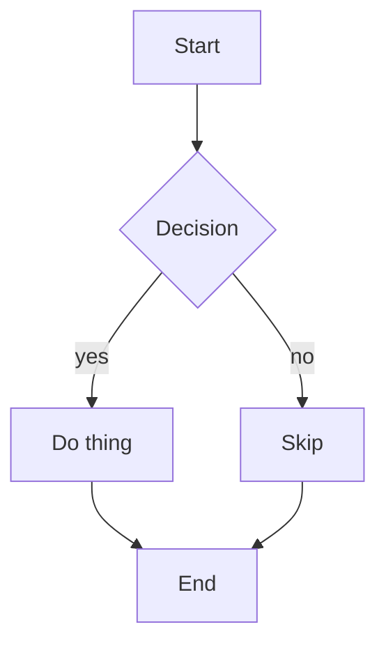

## Mermaid sequence

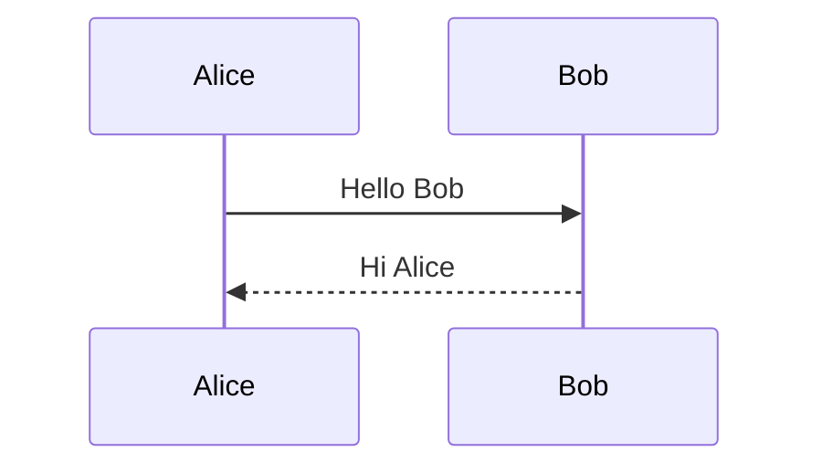

## Mermaid class

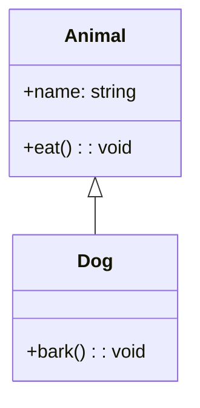

## Mermaid ER

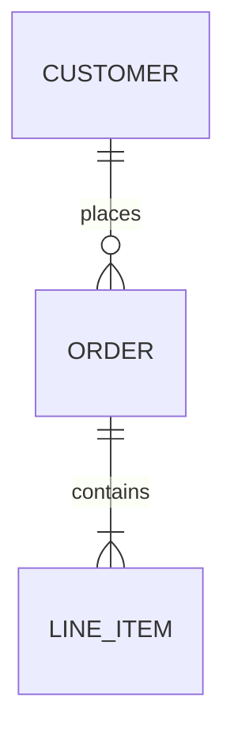

## Mermaid state

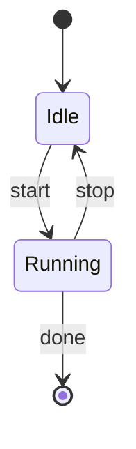

## Mermaid gantt

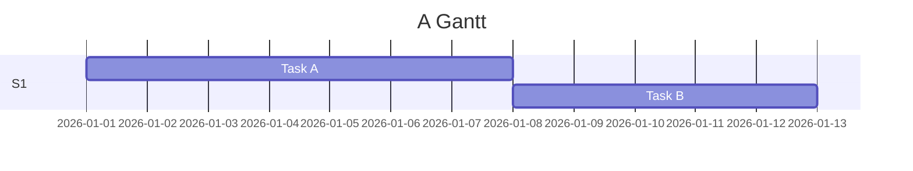

## Mermaid mindmap

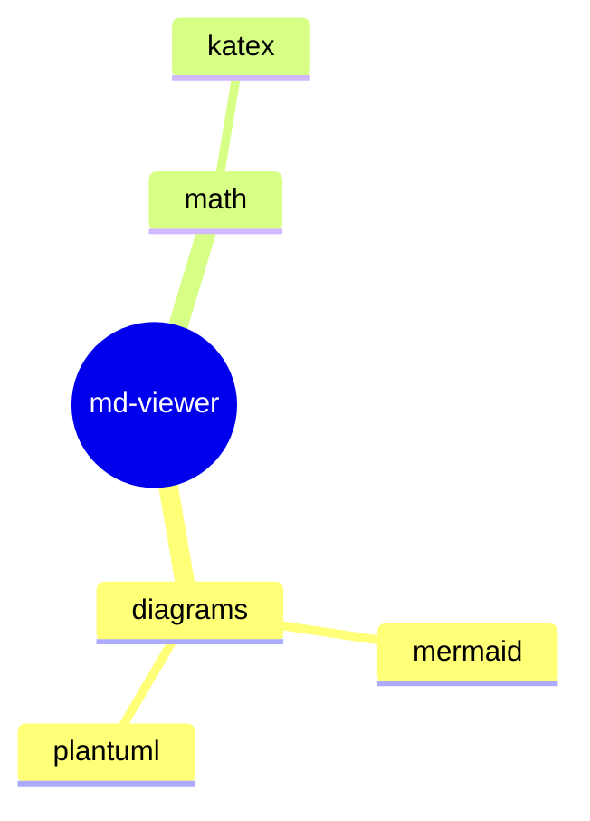

## PlantUML sequence

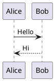

## PlantUML class

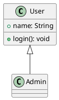

## PlantUML activity

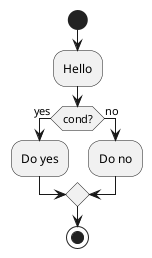

## PlantUML component

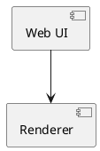

## PlantUML state

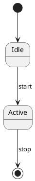

## PlantUML dark toggle

Toggle the Dark button in the toolbar; diagrams re-render.

## PlantUML broken syntax

```plantuml
@startuml
this is not valid uml !!!
@enduml
```

## Graphviz dot

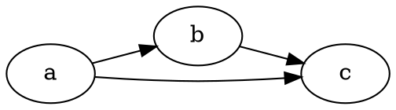

## WaveDrom

```wavedrom
{ "signal": [
  { "name": "clk", "wave": "p......" },
  { "name": "data", "wave": "x.345x.", "data": ["a","b","c"] }
]}
```

## Nomnoml

```nomnoml
[Customer] -> [Order]
[Order] -> [LineItem]
```

## ditaa (deferred)

```ditaa
+--------+   +-------+
|        |-->|       |
|  A     |   |  B    |
+--------+   +-------+
```

## 100-node mermaid stress


